<!-- i18n-source: README.md@1f4728c25cb15374fc4d6b3a791d4d4c9651548e status=reviewed -->
<!-- brand:start -->

<p align="center"><picture><source media="(prefers-color-scheme: dark)" srcset="https://raw.githubusercontent.com/muhittincamdali/SwiftUI-Data-Visualization/master/.github/brand/banner-es-dark.svg"><source media="(prefers-color-scheme: light)" srcset="https://raw.githubusercontent.com/muhittincamdali/SwiftUI-Data-Visualization/master/.github/brand/banner-es-light.svg"></picture></p>

<!-- lang-selector:start -->
<p align="center"><a href="README.md">English</a> · <a href="README.tr.md">Türkçe</a> · <a href="README.zh-CN.md">简体中文</a> · <a href="README.ja.md">日本語</a> · <a href="README.ko.md">한국어</a> · <a href="README.es.md">Español</a> · <a href="README.de.md">Deutsch</a> · <a href="README.fr.md">Français</a> · <a href="README.pt-BR.md">Português (Brasil)</a> · <a href="README.ru.md">Русский</a></p>
<!-- lang-selector:end -->

<p align="center">
<a href="https://github.com/muhittincamdali/SwiftUI-Data-Visualization/actions/workflows/ci.yml"></a>
<a href="https://github.com/muhittincamdali/SwiftUI-Data-Visualization/releases"><picture><source media="(prefers-color-scheme: dark)" srcset="https://raw.githubusercontent.com/muhittincamdali/SwiftUI-Data-Visualization/master/.github/brand/badge-version-dark.svg"><source media="(prefers-color-scheme: light)" srcset="https://raw.githubusercontent.com/muhittincamdali/SwiftUI-Data-Visualization/master/.github/brand/badge-version-light.svg"></picture></a>
<a href="https://github.com/muhittincamdali/SwiftUI-Data-Visualization/blob/master/Package.swift"><picture><source media="(prefers-color-scheme: dark)" srcset="https://raw.githubusercontent.com/muhittincamdali/SwiftUI-Data-Visualization/master/.github/brand/badge-platforms-dark.svg"><source media="(prefers-color-scheme: light)" srcset="https://raw.githubusercontent.com/muhittincamdali/SwiftUI-Data-Visualization/master/.github/brand/badge-platforms-light.svg"></picture></a>
<a href="https://github.com/muhittincamdali/SwiftUI-Data-Visualization/blob/master/Package.swift"><picture><source media="(prefers-color-scheme: dark)" srcset="https://raw.githubusercontent.com/muhittincamdali/SwiftUI-Data-Visualization/master/.github/brand/badge-language-dark.svg"><source media="(prefers-color-scheme: light)" srcset="https://raw.githubusercontent.com/muhittincamdali/SwiftUI-Data-Visualization/master/.github/brand/badge-language-light.svg"></picture></a>
<a href="https://github.com/muhittincamdali/SwiftUI-Data-Visualization/blob/master/LICENSE"><picture><source media="(prefers-color-scheme: dark)" srcset="https://raw.githubusercontent.com/muhittincamdali/SwiftUI-Data-Visualization/master/.github/brand/badge-license-dark.svg"><source media="(prefers-color-scheme: light)" srcset="https://raw.githubusercontent.com/muhittincamdali/SwiftUI-Data-Visualization/master/.github/brand/badge-license-light.svg"></picture></a>
</p>

<p align="center">
<a href="#inicio-rápido"><picture><source media="(prefers-color-scheme: dark)" srcset="https://raw.githubusercontent.com/muhittincamdali/SwiftUI-Data-Visualization/master/.github/brand/button-start-es-dark.svg"><source media="(prefers-color-scheme: light)" srcset="https://raw.githubusercontent.com/muhittincamdali/SwiftUI-Data-Visualization/master/.github/brand/button-start-es-light.svg"></picture></a>
<a href="https://muhittincamdali.github.io/SwiftUI-Data-Visualization/documentation/swiftuidatavisualization/"><picture><source media="(prefers-color-scheme: dark)" srcset="https://raw.githubusercontent.com/muhittincamdali/SwiftUI-Data-Visualization/master/.github/brand/button-docs-es-dark.svg"><source media="(prefers-color-scheme: light)" srcset="https://raw.githubusercontent.com/muhittincamdali/SwiftUI-Data-Visualization/master/.github/brand/button-docs-es-light.svg"></picture></a>
<a href="https://github.com/muhittincamdali/SwiftUI-Data-Visualization/tree/master/Examples"><picture><source media="(prefers-color-scheme: dark)" srcset="https://raw.githubusercontent.com/muhittincamdali/SwiftUI-Data-Visualization/master/.github/brand/button-examples-es-dark.svg"><source media="(prefers-color-scheme: light)" srcset="https://raw.githubusercontent.com/muhittincamdali/SwiftUI-Data-Visualization/master/.github/brand/button-examples-es-light.svg"></picture></a>
</p>

> Esta es una traducción del README en inglés. Si hay diferencias, la versión en inglés es la vigente.

<!-- brand:end -->

Un paquete de Swift con vistas de gráficos para SwiftUI en iOS 17+ y macOS 14+, basado en Swift Charts. Cubre los gráficos que Swift Charts te deja resolver por tu cuenta (series temporales con decenas de miles de puntos, histogramas, diagramas de caja, líneas de tendencia, velas japonesas, cascadas, mapas de calor, gráficos de radar, treemaps y teletipos en vivo) y hace público el análisis que hay detrás, de modo que puedes usarlo en un `Chart` propio. El paquete no tiene dependencias.

## Lo más destacado

- **10 vistas de gráficos**: `TimeSeriesChart`, `HistogramChart`, `BoxPlotChart`, `ScatterChart`,
  `CandlestickChart`, `WaterfallChart`, `HeatmapChart`, `RadarChart`, `TreemapChart` y
  `LiveTickerChart`. Cada una recibe tipos de valor simples y solo necesita un frame.
- **Datos grandes y en vivo**: `TimeSeriesChart` reduce cada serie a 1.000 puntos con
  Largest-Triangle-Three-Buckets, así que 50.000 lecturas por serie siguen fluidas; puede desplazarse
  por una ventana de tiempo e informar de la fecha seleccionada. `LiveSeries` guarda los últimos
  valores en un búfer circular para `LiveTickerChart`.
- **El análisis es público**: `Histogram` (Sturges, Freedman–Diaconis, ancho fijo o número fijo),
  `BoxPlotSummary` (bigotes de Tukey), `Statistics`, `LinearRegression`, `MovingAverage`,
  las marcas de eje de `NiceScale`, `TreemapLayout` (squarified), `Candle.aggregate` y `Downsampling`.
- **Seguro con cualquier entrada**: los valores no finitos y las fechas fuera de los años 1 a 4001
  se descartan, los valores finitos más allá de ±1e307 se dibujan en ese límite,
  los rangos cercanos a `Double.greatestFiniteMagnitude` y los rangos subnormales se
  mantienen finitos, y el número de marcas, los intervalos (bins), los búferes, las ventanas de
  desplazamiento y las exportaciones tienen límites superiores. Un conjunto de pruebas específico
  pasa `nan`, infinito, `Int.max`, rangos extremos y fechas extremas a los tipos de análisis y a
  los gráficos.
- **Accesible**: las vistas basadas en Swift Charts incluyen navegación con VoiceOver y Audio Graphs,
  con etiquetas legibles para intervalos, cajas, velas y pasos; las vistas dibujadas sin Swift Charts (radar,
  treemap, teletipo) adjuntan un `AudioGraphDescriptor`. Incluye una paleta apta para personas con
  daltonismo.
- **Probado**: 188 pruebas de Swift Testing en 33 suites, que se ejecutan en macOS y en un simulador
  de iPhone, e incluyen renderizados fuera de pantalla de cada ejemplo del README en modo claro y oscuro.
- **Ejemplos de uso que compilan**: cada ejemplo de abajo procede de la
  [app de ejemplo](Examples/ChartGallery), que la CI compila para iOS y macOS.

### Qué incluye

| Área                | Tipos                                                                                         |
| ------------------- | --------------------------------------------------------------------------------------------- |
| Series temporales   | `TimeSeriesChart`, `TimeSeries`, `TimeSeriesPoint`, `MovingAverage`, `Downsampling`            |
| Estadística         | `HistogramChart`, `Histogram`, `BoxPlotChart`, `BoxPlotSummary`, `ScatterChart`, `LinearRegression`, `Statistics` |
| Finanzas            | `CandlestickChart`, `Candle`, `WaterfallChart`, `WaterfallStep`                               |
| Cuadrículas y formas | `HeatmapChart`, `HeatmapCell`, `RadarChart`, `RadarGeometry`, `TreemapChart`, `TreemapLayout` |
| Datos en vivo       | `LiveTickerChart`, `LiveSeries`, `RingBuffer`                                                 |
| Compartido          | `ChartPalette` y `.chartPalette(_:)`, `NiceScale`, `ChartExport`, `AudioGraphDescriptor`    |

## Inicio rápido

**1. Añade el paquete**

En Xcode, elige **File › Add Package Dependencies…** e introduce la URL del repositorio:

```text
https://github.com/muhittincamdali/SwiftUI-Data-Visualization.git
```

Pégala en el campo de búsqueda de la esquina superior derecha de la ventana. Deja **Dependency Rule** en **Up to Next Major Version** desde `2.0.0` y haz clic en **Add Package**. En la ventana siguiente, elige el target de tu app junto a **SwiftUIDataVisualization** y haz clic de nuevo en **Add Package**.

**2. Importa el módulo**

```swift
import SwiftUIDataVisualization
```

Pon esta línea al principio del archivo Swift donde dibujes un gráfico, debajo de `import SwiftUI`.

**3. Úsalo**

En una app nueva de Xcode (**File › New › Project… › App**), sustituye todo el contenido de `ContentView.swift` por:

```swift
import SwiftUI
import SwiftUIDataVisualization

struct ContentView: View {
    let steps = TimeSeries(
        name: "Steps",
        values: [4_200, 8_100, 6_900, 10_400, 7_800, 12_100, 9_300],
        start: .now.addingTimeInterval(-6 * 86_400),
        interval: 86_400
    )

    var body: some View {
        TimeSeriesChart(steps)
            .frame(height: 240)
            .padding()
    }
}
```

Pulsa **Run** (⌘R). La app muestra una línea azul con los últimos siete días; toca la línea (o pasa el puntero por encima en el Mac) para ver la fecha y el número de pasos.

## Instalación

### Swift Package Manager

En Xcode, elige **File › Add Package Dependencies…** e introduce la URL del repositorio:

```text
https://github.com/muhittincamdali/SwiftUI-Data-Visualization.git
```

O añádelo a las `dependencies` de tu `Package.swift`:

```swift
dependencies: [
    .package(url: "https://github.com/muhittincamdali/SwiftUI-Data-Visualization.git", from: "2.0.0")
],
targets: [
    .target(name: "YourApp", dependencies: [
        .product(name: "SwiftUIDataVisualization", package: "SwiftUI-Data-Visualization")
    ])
]
```

La versión 2.0.0 (octubre de 2026) es la primera versión de los gráficos que se describen aquí. La anterior, la 1.0.0, tenía una API distinta que no compilaba con las versiones actuales de Xcode; la 2.0.0 también incorpora el trabajo de SwiftUI-Charts-Pro, que va a archivarse. [CHANGELOG.md](CHANGELOG.md) enumera los cambios, incluidos los que rompen la compatibilidad.

## Uso

Los ejemplos de abajo están copiados de
[`Examples/ChartGallery/ChartGallery/ReadmeSamples.swift`](Examples/ChartGallery/ChartGallery/ReadmeSamples.swift).
La app de ejemplo y el conjunto de pruebas compilan ese archivo.

### Series temporales

```swift
struct ServerLoad: View {
    // 50,000 readings per server, one every 30 seconds; the chart draws 1,000 of each.
    let servers = [readings(name: "api-1", phase: 0), readings(name: "api-2", phase: 1)]

    static func readings(name: String, phase: Double) -> TimeSeries {
        let values = (0..<50_000).map { index -> Double in
            let wave = 25 * sin(Double(index) / 3_000 + phase)
            let noise = Double(index % 97) / 40
            return 40 + wave + noise
        }
        return TimeSeries(name: name, values: values, start: Date(timeIntervalSinceReferenceDate: 800_000_000), interval: 30)
    }

    var body: some View {
        TimeSeriesChart(servers, movingAverageWindow: 2_000)
            .frame(height: 240)
            .padding()
    }
}
```

Las líneas discontinuas son las medias móviles de 2.000 lecturas. Pasa `style: .area` para rellenar el espacio bajo las líneas.

### Desplazamiento, selección y exportación

```swift
struct ScrollingHistory: View {
    @State private var selected: Date?
    @State private var exported: Data?
    let load = ServerLoad.readings(name: "api-1", phase: 0)

    var chart: some View {
        // Two days at a time out of 17; the chart opens at the newest data.
        TimeSeriesChart(load, selection: $selected, visibleDuration: 2 * 86_400)
    }

    var body: some View {
        VStack(alignment: .leading, spacing: 12) {
            Text(selected.map { "Selected \($0.formatted(date: .abbreviated, time: .shortened))" } ?? "Touch the chart")
                .font(.headline)
            chart
                .frame(height: 220)
            Button("Export PNG") {
                exported = ChartExport.pngData(of: chart, size: CGSize(width: 600, height: 300))
            }
            if let exported {
                Text("\(exported.count) bytes")
            }
        }
        .padding()
    }
}
```

### Estadística

```swift
struct LatencyReport: View {
    let ios: [Double] = [112, 98, 130, 101, 145, 120, 99, 180, 104, 117, 125, 133, 230, 108, 121]
    let android: [Double] = [140, 151, 128, 160, 149, 171, 138, 155, 162, 147, 158, 133, 166, 152]

    var body: some View {
        VStack(spacing: 24) {
            HistogramChart(values: ios + android, binning: .width(25), valueLabel: "Latency (ms)")
                .frame(height: 180)
            BoxPlotChart([
                .init(name: "iOS", values: ios),
                .init(name: "Android", values: android),
            ], valueLabel: "Latency (ms)")
            .frame(height: 200)
        }
        .padding()
    }
}
```

Sin `binning`, el histograma elige el ancho de los intervalos con la regla de Sturges o la de Freedman–Diaconis, la que dé más intervalos. El diagrama de caja marca como atípicos los valores que quedan a más de 1,5 rangos intercuartílicos.

### Línea de tendencia

```swift
struct HeightWeight: View {
    let people: [PlotPoint] = [
        .init(x: 158, y: 54), .init(x: 163, y: 60), .init(x: 167, y: 59), .init(x: 171, y: 68),
        .init(x: 174, y: 70), .init(x: 178, y: 74), .init(x: 181, y: 77), .init(x: 186, y: 85),
    ]

    var body: some View {
        ScatterChart(people, xLabel: "Height (cm)", yLabel: "Weight (kg)", showsTrendLine: true)
            .frame(height: 220)
            .padding()
    }
}
```

### Finanzas

```swift
struct PriceAndProfit: View {
    // Trades every 5 minutes for three days, grouped into one candle per 6 hours.
    let candles = Candle.aggregate(trades, interval: 6 * 3_600)

    static let trades = (0..<864).map { index -> TimeSeriesPoint in
        let date = Date(timeIntervalSinceReferenceDate: 800_000_000 + Double(index) * 300)
        let price = 100 + 6 * sin(Double(index) / 40) + Double(index % 13) / 4
        return TimeSeriesPoint(date: date, value: price)
    }

    var body: some View {
        VStack(spacing: 24) {
            CandlestickChart(candles)
                .frame(height: 200)
            WaterfallChart([
                WaterfallStep("Revenue", 420),
                WaterfallStep("Costs", -260),
                WaterfallStep("Tax", -40),
                .total("Profit"),
            ])
            .frame(height: 200)
        }
        .padding()
    }
}
```

### Mapa de calor

```swift
struct CommitActivity: View {
    let days = ["Mon", "Tue", "Wed", "Thu", "Fri"]
    let hours = ["9", "11", "13", "15", "17"]

    var cells: [HeatmapCell] {
        days.enumerated().flatMap { day, dayName in
            hours.enumerated().map { hour, hourName in
                HeatmapCell(column: hourName, row: dayName, value: Double((day * 7 + hour * 3) % 11))
            }
        }
    }

    var body: some View {
        HeatmapChart(cells, valueLabel: "Commits", showsValues: true)
            .frame(height: 220)
            .padding()
    }
}
```

### Radar y treemap

```swift
struct ProfileAndStorage: View {
    var body: some View {
        VStack(spacing: 24) {
            RadarChart(
                axes: ["Speed", "Power", "Range", "Comfort", "Price"],
                series: [
                    .init(name: "Model A", values: [8, 6, 7, 9, 5]),
                    .init(name: "Model B", values: [6, 9, 5, 6, 8]),
                ],
                maximum: 10
            )
            .frame(height: 260)
            TreemapChart([
                TreemapItem("Photos", value: 48),
                TreemapItem("Apps", value: 31),
                TreemapItem("Music", value: 12),
                TreemapItem("Mail", value: 6),
                TreemapItem("Notes", value: 3),
            ])
            .frame(height: 200)
        }
        .padding()
    }
}
```

### Datos en vivo

```swift
struct LiveLoad: View {
    @State private var load = LiveSeries(capacity: 120)

    var body: some View {
        LiveTickerChart(values: load.values, title: "CPU load")
            .frame(height: 80)
            .padding()
            .task {
                var tick = 0.0
                while !Task.isCancelled {
                    tick += 1
                    load.append(50 + 30 * sin(tick / 8)) // read the real value here
                    try? await Task.sleep(for: .milliseconds(100))
                }
            }
    }
}
```

### Colores

```swift
struct ColorblindSafeCharts: View {
    var body: some View {
        LatencyReport()
            .chartPalette(.colorblindSafe)
    }
}
```

Todos los gráficos que quedan por debajo del modificador usan la paleta. La paleta por defecto, `.ocean`, es la paleta azul de las capturas de pantalla; crea la tuya con `ChartPalette(series:positive:negative:neutral:gradient:)`.

## Demo

| Claro                                                          | Oscuro                                                       |
| -------------------------------------------------------------- | ------------------------------------------------------------ |
| 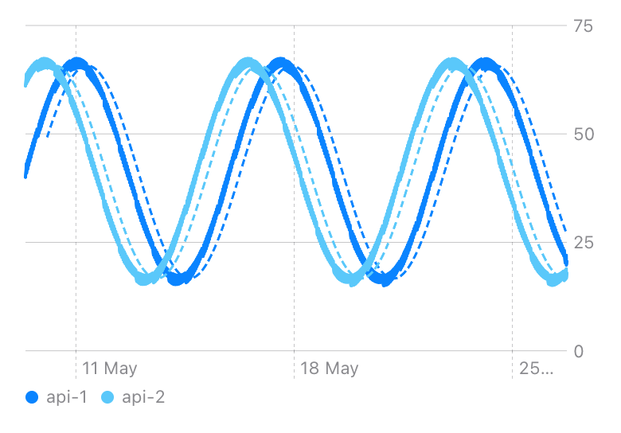 | 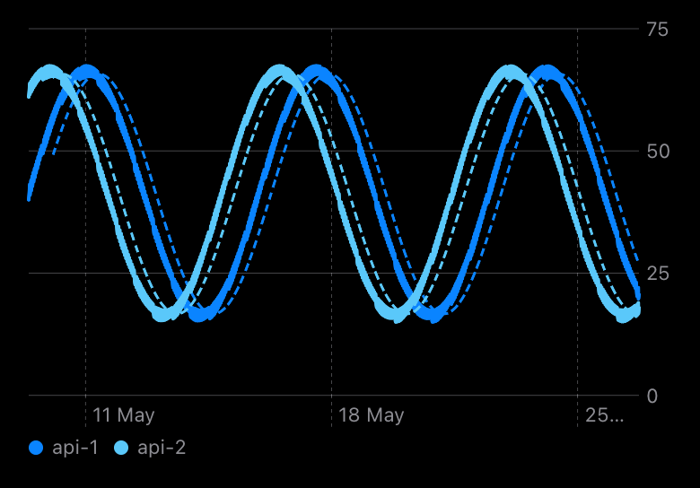 |
| 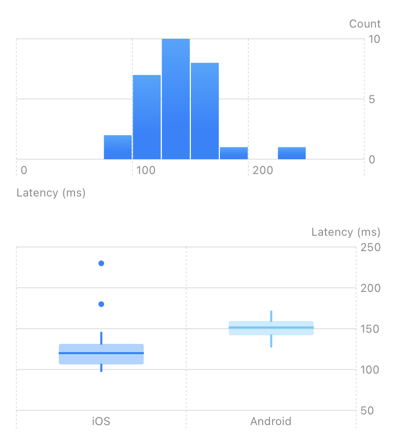        | 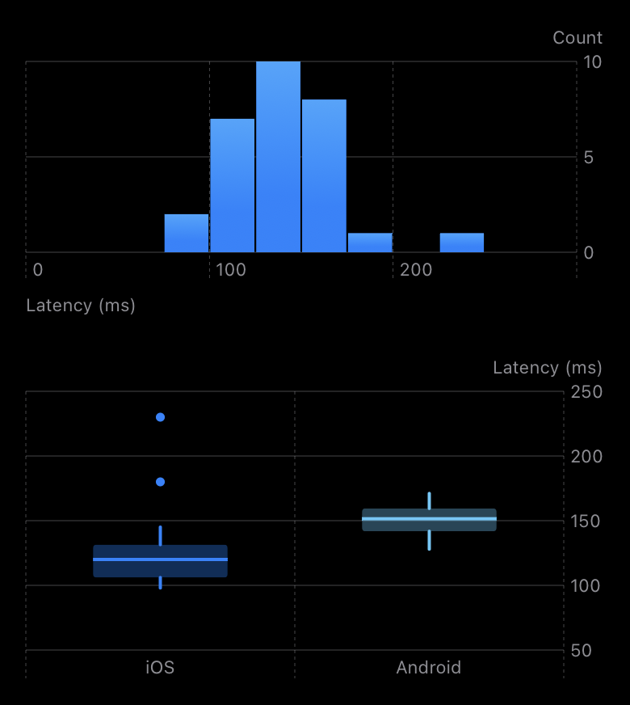      |
| 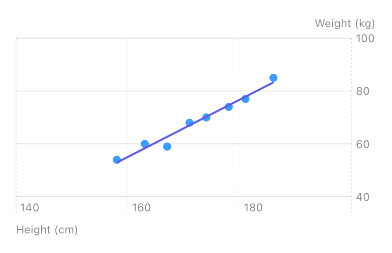 | 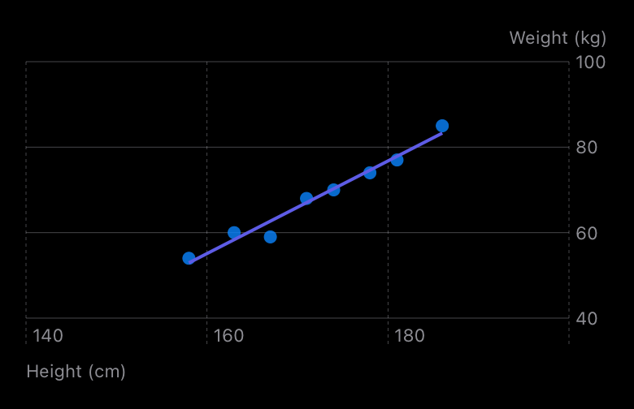 |
| 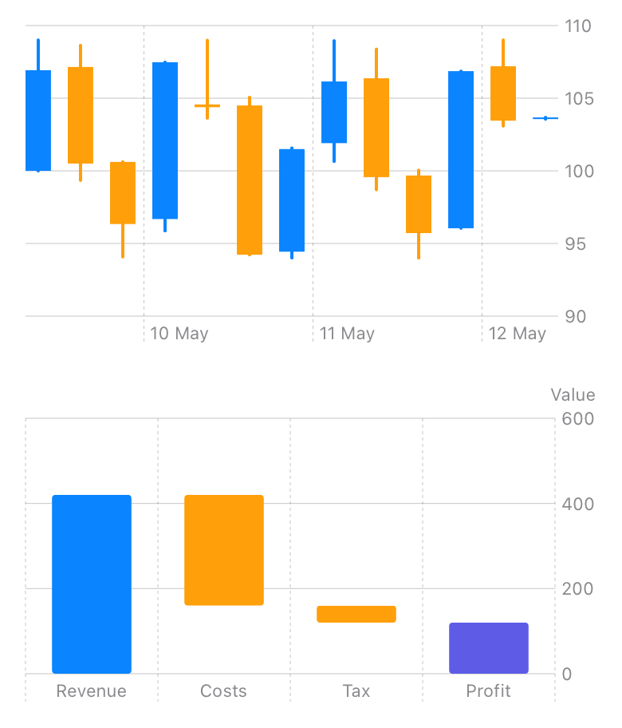              | 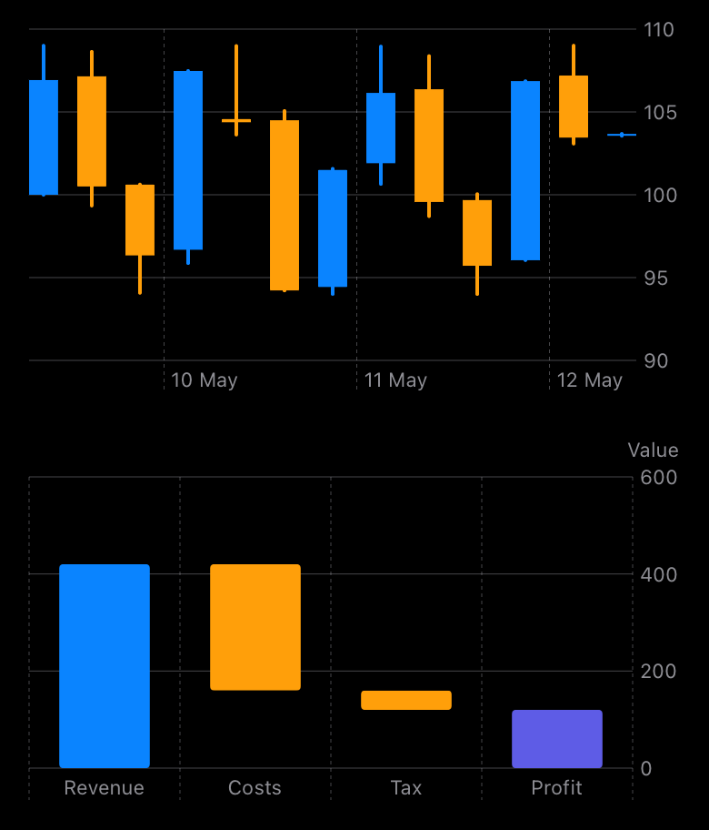            |
| 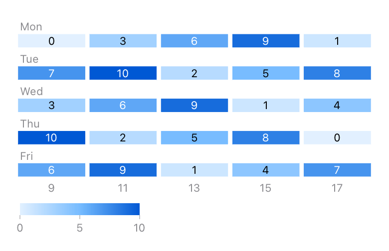         | 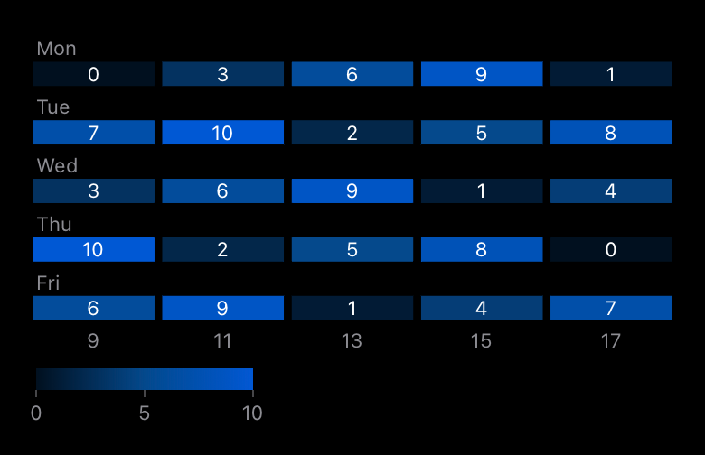       |
| 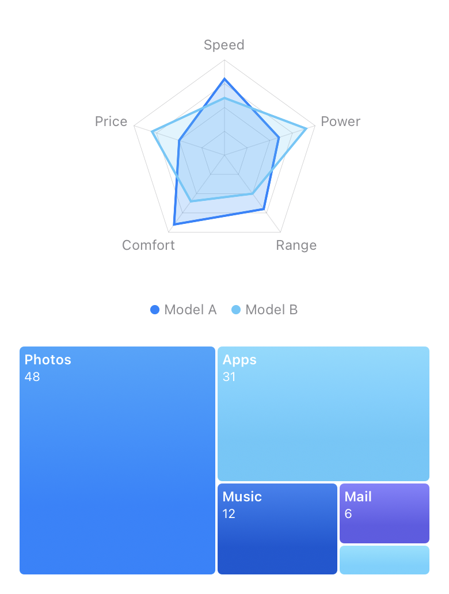 | 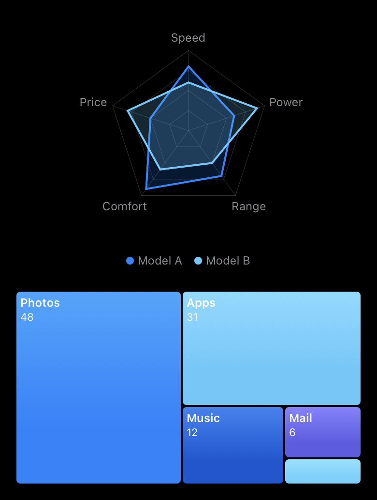 |

Las imágenes se renderizan en el simulador de iOS a partir de los ejemplos de Uso con
[`Tests/SwiftUIDataVisualizationTests/RenderTests.swift`](Tests/SwiftUIDataVisualizationTests/RenderTests.swift)
y [`scripts/generate-screenshots.sh`](scripts/generate-screenshots.sh).

Las pantallas de series temporales y de datos en vivo de la app de ejemplo, capturadas en un simulador de iPhone con
[`scripts/capture-example-screens.sh`](scripts/capture-example-screens.sh):

| Series temporales                                                | Datos en vivo                                                |
| ---------------------------------------------------------------- | ------------------------------------------------------------ |
| 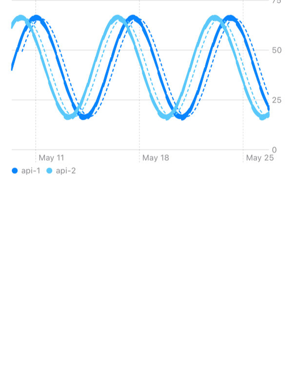 |  |
| 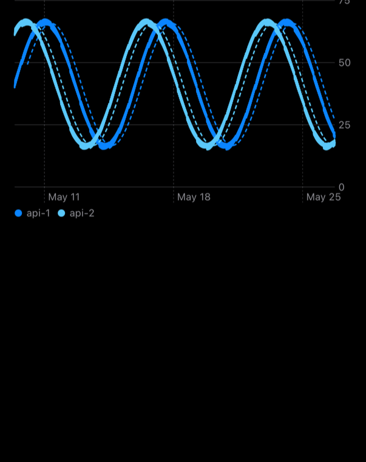 |  |

Para probar los gráficos tú mismo, abre `ChartGallery.xcodeproj` en [`Examples/ChartGallery`](Examples/ChartGallery) con Xcode, elige un simulador de iPhone o **My Mac** y pulsa **Run**. La app tiene una pantalla por cada ejemplo anterior; [Examples/README.md](Examples/README.md) da más detalles.

## Documentación

Documentación de referencia y artículos:

- [Referencia de la API](https://muhittincamdali.github.io/SwiftUI-Data-Visualization/documentation/swiftuidatavisualization/)
  (DocC, publicada en GitHub Pages desde `master`)
- Compílala en local en Xcode con **Product › Build Documentation**, o desde la línea de comandos:

```sh
xcodebuild docbuild -scheme SwiftUIDataVisualization -destination 'generic/platform=macOS'
```

## Guías

- [Getting Started](https://muhittincamdali.github.io/SwiftUI-Data-Visualization/documentation/swiftuidatavisualization/gettingstarted)
  — añade el paquete, dibuja un primer gráfico, asigna tus propios datos y define una paleta
  ([código fuente](Sources/SwiftUIDataVisualization/SwiftUIDataVisualization.docc/GettingStarted.md)).
- [Choosing a Chart](https://muhittincamdali.github.io/SwiftUI-Data-Visualization/documentation/swiftuidatavisualization/choosingachart)
  — qué gráfico responde a qué pregunta, y la estadística que hay detrás
  ([código fuente](Sources/SwiftUIDataVisualization/SwiftUIDataVisualization.docc/ChoosingAChart.md)).
- [Large and Live Data](https://muhittincamdali.github.io/SwiftUI-Data-Visualization/documentation/swiftuidatavisualization/largeandlivedata)
  — reducción de muestras, desplazamiento por historiales largos, valores en vivo y los límites de entrada
  ([código fuente](Sources/SwiftUIDataVisualization/SwiftUIDataVisualization.docc/LargeAndLiveData.md)).
- [Accessible Charts](https://muhittincamdali.github.io/SwiftUI-Data-Visualization/documentation/swiftuidatavisualization/accessiblecharts)
  — qué lee VoiceOver en cada gráfico y la paleta apta para personas con daltonismo
  ([código fuente](Sources/SwiftUIDataVisualization/SwiftUIDataVisualization.docc/AccessibleCharts.md)).

## Requisitos

| Plataforma  | Versión mínima        |
| ----------- | --------------------- |
| iOS         | 17                    |
| macOS       | 14                    |
| Herramientas | Swift 6.2 · Xcode 26+ |

La CI compila con el Xcode por defecto de la imagen de ejecutor `macos-26` de GitHub. El paquete se desarrolla con Xcode 27.

## Arquitectura

- `Sources/SwiftUIDataVisualization/Charts/` contiene un archivo por cada vista de gráfico. Siete de
  ellas son `Chart`s de Swift Charts; `RadarChart`, `TreemapChart` y `LiveTickerChart` dibujan con
  `Canvas` o con vistas simples, porque Swift Charts no tiene coordenadas polares ni de treemap, y un
  teletipo que se redibuja a la frecuencia de la pantalla sale más barato en una sola pasada de `Canvas`.
- `Analysis/`, `Layout/` y `Data/` contienen los tipos de valor y las funciones que usan los gráficos
  (`Histogram`, `BoxPlotSummary`, `LinearRegression`, `NiceScale`, `TreemapLayout`, `Candle`, …). No
  tienen código de vistas y son `Sendable`, así que pueden ejecutarse fuera del actor principal.
- La preparación que hace cada gráfico antes de dibujar (reducción de muestras, dominios de los
  bigotes, anchos de los cuerpos de las velas, barras de la cascada, máximo del radar) vive en
  funciones `nonisolated static` que las pruebas llaman directamente.
- `Streaming/` tiene `RingBuffer` y `LiveSeries`, el único tipo de referencia, una clase `@Observable`
  en el actor principal. `Style/ChartPalette.swift` pasa los colores por el entorno (environment).
- La CI ejecuta `swift test` en macOS y `xcodebuild test` en un simulador de iPhone, compila la app
  de ejemplo para iOS y macOS y publica la documentación de DocC.

Ejecuta las pruebas en local:

```sh
swift test                                    # macOS
xcodebuild test -scheme SwiftUIDataVisualization \
  -destination 'platform=iOS Simulator,name=iPhone 17'
```

## Hoja de ruta

- Añadir el paquete al Swift Package Index; `.spi.yml` ya está en el repositorio.
- Zoom con pellizco en el eje de tiempo de `TimeSeriesChart`.
- Probar y habilitar visionOS, que Swift Charts admite.

## Contribuir

Las contribuciones son bienvenidas. Lee la [guía de contribución](https://github.com/muhittincamdali/SwiftUI-Data-Visualization/blob/master/CONTRIBUTING.md) y el [código de conducta](https://github.com/muhittincamdali/.github/blob/main/CODE_OF_CONDUCT.md) antes de abrir una pull request. Informa de los problemas de seguridad de forma privada, como se describe en la [política de seguridad](https://github.com/muhittincamdali/.github/blob/main/SECURITY.md).

## Licencia

Publicado bajo la licencia MIT. Consulta [LICENSE](LICENSE).
